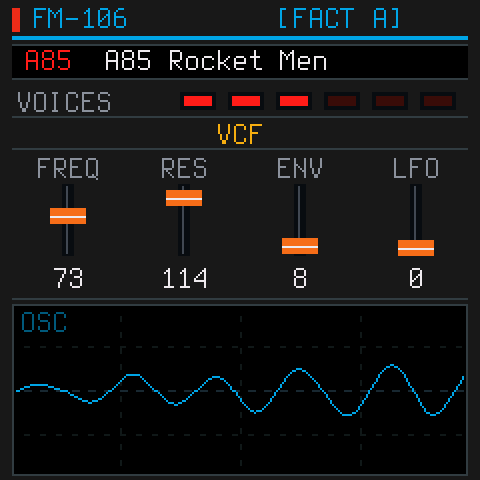
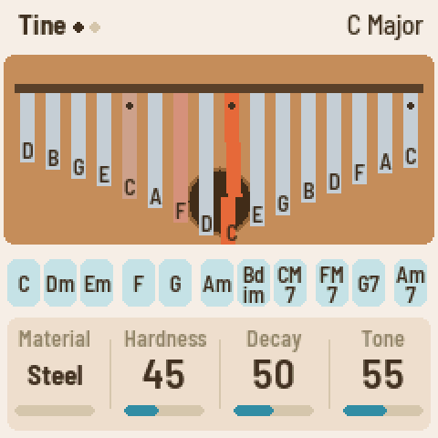
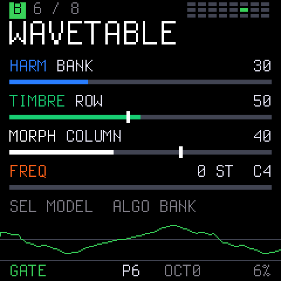
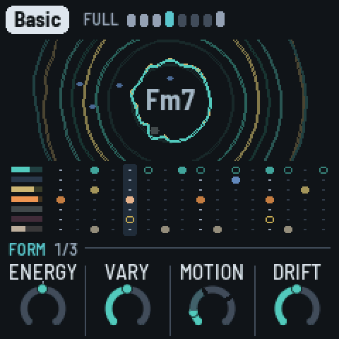

<p align="center">
  <picture>
    <source media="(prefers-color-scheme: dark)" srcset="docs/media/fm1-dock-light.svg">
    
  </picture>
</p>

<p align="center"><b>One firmware for the M-VAVE FM-1. Many synths.</b></p>

<p align="center">
  <a href="https://github.com/joakimeriksson/fm1-dock/releases/latest"></a>
  <a href="LICENSING.md"></a>
</p>

<p align="center">
  <a href="https://joakimeriksson.github.io/fm1-dock/"><b>The page</b></a>:
  <a href="https://joakimeriksson.github.io/fm1-dock/#install">install</a> ·
  <a href="https://joakimeriksson.github.io/fm1-dock/guide.html"><b>the player's guide</b></a> ·
  <a href="https://joakimeriksson.github.io/fm1-dock/#modules">the catalog</a> ·
  <a href="https://joakimeriksson.github.io/fm1-dock/#play">the video</a> ·
  <a href="https://joakimeriksson.github.io/fm1-dock/#console">the console</a> ·
  <a href="https://joakimeriksson.github.io/fm1-dock/#emulator">the emulator</a> ·
  <a href="https://thefirmwarehub.com/#fw-fm1dock">on the FM-1 Firmware Hub</a> ·
  <a href="ROADMAP.md">the roadmap</a>
</p>

fm1-dock is installed once. The synths are modules in its flash: hold HOME, pick another one, play. No reinstall.
Fifteen synths so far, each its author's own code: three come with it (and a sine), twelve more go in from the page
with one click, and out again. Every one can be tried first, without an FM-1: its card's **Try it** runs it in the emulator on the page. Your own module deploys the same way, over USB in seconds, and when something goes wrong, the log, the
crash record and the render load are one click away in the browser. It also runs on the M-Vave SMK-37 keyboards.

<p align="center">
  
  
  
  
  
  
  <br>
  
  
  
  
  
  
</p>

## Install

1. Open **[the page](https://joakimeriksson.github.io/fm1-dock/#install)** in Chrome or Edge on a computer, plug in
   the FM-1 with a USB data cable and press **Connect over USB**. Nothing is written until you press a button.
2. Press **Install fm1-dock**. CS-1, Scintilla, OberVave and the sine come with it. Coming from an older fm1-dock,
   your added modules, settings and presets stay.
3. **Add** the modules you want from [the catalog](https://joakimeriksson.github.io/fm1-dock/#modules). Then hold
   HOME on the FM-1, pick a synth and play.

Every release is built from this source and signed on GitHub by the Firmware Hub's shared workflow
([zvenson/fm1-build](https://github.com/zvenson/fm1-build)), so each package carries a build attestation:

```sh
gh attestation verify fm1-dock-1.0.0.fwsc -R joakimeriksson/fm1-dock --signer-repo zvenson/fm1-build
```

fm1-dock is also on the [FM-1 Firmware Hub](https://thefirmwarehub.com/#fw-fm1dock), its card with the current release.

Without a browser, download `fm1-dock-X.Y.fwsc` from the [latest release](https://github.com/joakimeriksson/fm1-dock/releases/latest)
and install it over USB:

```sh
pip3 install mido python-rtmidi
python3 tools/fm1_install.py fm1-dock-1.0.0.fwsc   # asks before it writes, restarts into fm1-dock
```

**M-Vave SMK-37** (Pro, Elite, MKE-P37) and Donner Starrykey 37 Play: read [SMK37.md](SMK37.md) first. Each model has
its own package; the installers refuse an FM-1 package on an SMK-37, and the other way round.

Back to any other firmware, or the official one, with the [FM-1 Firmware Hub](https://fm1.designburgapps.com) in
Chrome or Edge: fm1-dock answers the hub's updater like every firmware there. Installing firmware is at your own risk.

## New in 1.0

One firmware, many synths, now with room for them and effects under them.

- **The open dock.** Every synth is an add-on. The Empty dock carries only the sine; CS-1, Scintilla and OberVave are
  add-ons like the rest, and the `-analog` and `-digital` packs come ready-made. The add-ons' room is the flash the
  built-ins no longer fill, and the boot slot is gone ([#115](https://github.com/joakimeriksson/fm1-dock/issues/115),
  [#107](https://github.com/joakimeriksson/fm1-dock/issues/107)): on an FM-1 472 KiB with Standard (it was 296; the
  same figure as a unit reports) and 744 KiB with the Empty dock; on an SMK-37 448 KiB (it was 416).
- **29 synths in the catalog**, from CS-1 and Scintilla to PROPHET, FM6, ARP 2600, ESQ-1, ORRERY and the newcomers
  S1VAVE, EMINENT, MINIPOPS, ENSEMBLE, FLAT-20 and JT-80X0.
- **Fixes**: newer FM-1s (late 2026) have another display panel, washed out until now: fm1-dock sends M-Vave's own
  display setup, as the official firmware does (Scintilla 0.3.3 and FM-1 SID 0.3.1 too). Every knob click counts at any
  speed (#137); with OPTIONS > KNOBS CC on, the first turn of K1-K4 says that they send MIDI. The effects no longer
  flatten a big chord (#139).
- **Effects as add-ons** ([#122](https://github.com/joakimeriksson/fm1-dock/issues/122)): one effect under whatever synth
  plays, picked in OPTIONS > EFFECT. Eight are in the catalog: CHORUS, FLANGER, DELAY, TRIO, and new in 1.0 PHASER,
  TREMOLO, DRIVE (overdrive and distortion) and CRUSH (a bit crusher). [Listen to them, add them and write your own](https://joakimeriksson.github.io/fm1-dock/effects.html).
- **Your sounds are yours.** Presets in a file: back up, export, restore and delete banks over USB, on the page and
  with `dock.py bank-get` / `bank-put` ([#117](https://github.com/joakimeriksson/fm1-dock/issues/117)). Scintilla keeps
  sounds of your own: SAVE, PRESETS for USR 1 to 12, SAVE again (#118, #125). A bank save that fails now says NOT SAVED
  on the screen (#114).
- **Import**: FM6 and PROPHET take a `.syx` file from the page (#120). They cannot save an edited sound yet.
- **The SMK-37's own keys and pads**: the outer keys beside the middle ones, with LOCAL, MIDI CH and the octave (#123);
  the pads in OPTIONS > PADS as NOTES, OFF or CHORDS in a major key (#124).
- **MIDI clock and transport** reach the synth on time, from the TRS jack too (#110).
- **A safer restart**: a module written where code ran is started after the restart, not before (#126, #87).
- **An add counter on the page**: the page counts how many times each add-on is added ([below](#the-add-counter)).
- **Guides** for players and for anyone adding a synth or an effect, and `tests/level_test.py`, which plays big chords
  through every add-on and fails on clipping (#97, #109).

Not yet tried: the SMK-37 Elite and MKE-P37 models, and an FM-1 with the newer flash chip (UC25HQ80). Both are accepted
by the installer; nobody has run 1.0 on them (#112, #99).

## New in 0.9 (a test release)

**[The 0.9 video](https://www.youtube.com/watch?v=INpj91BmUJM)**: the new synths and the big chords on an FM-1 and an SMK-37, their own sound
over USB.

- **The empty dock**: `fm1-dock-0.9.0-empty.fwsc` (and `-empty-smk37`, `-elite`, `-mke`) carries only the sine; you
  add the synths you want from the page, CS-1, Scintilla and OberVave among them (add-ons on the page too). The first
  step of the open dock ([ROADMAP.md](ROADMAP.md)). Your added synths, settings and presets stay either way. It does
  not yet give the add-ons more room: the flash the built-ins leave stays the firmware's until the next version
  ([#107](https://github.com/joakimeriksson/fm1-dock/issues/107)).
- **Synth packs**: the same firmware with other synths built in. `fm1-dock-0.9.0-analog.fwsc` carries CS-1, Scintilla,
  OberVave and PROPHET; `fm1-dock-0.9.0-digital.fwsc` FM6, ARTIHIVE and GATOR (the SMK-37's `-digital-smk37`: FM6,
  ARTIHIVE and KEYS). A built-in synth leaves the add-on room free for others. The page's Install step lets you pick
  any of them (Standard, Analog pack, Digital pack, Empty dock).
- **Big chords without distortion**: FM6, PROPHET and KEYS (and the FMINI-1 add-on, PIPE ORGAN above all) cut a loud
  chord flat at full scale before MASTER, so turning the volume down did not help. FM6 and PROPHET now mix as Melodee
  does (its level, limiter and soft clip), FMINI-1 as FMini-1 does, KEYS with a limiter of its own.
- **OPTIONS > AFTERTOUCH**: the keys' pressure as it comes (AS IS), or turned into channel pressure, the mod wheel or the
  filter (CC 74), so that synths which ignore poly aftertouch answer to pressing harder too (OberVave, for one, as MOD
  WHL or FILTER). On the SMK-37, whose keys sense no pressure, it turns an external keyboard's aftertouch.

## New add-ons

On the page now, for fm1-dock 1.0.0 (most run on 0.8.2 and later too); an add-on needs no new firmware:

- **KEYS**: a clavinet, an electric piano and a piano from physical models, 24 voices in 20 KiB. Velocity shapes
  each: a brighter pluck, more of the tine's bark, a harder hammer.
- **ATEK303** (Animatek): a TB-303 style acid machine with its own pattern generator; press PLAY and a line plays.
- **FLAT-20** (Brandon Matthews): a Korg MS-20 modelled from its service manual, with a patch panel; 26 presets.
- **JT-80X0** (bk40-home, formerly M-Vance): a JP-8000/8080-style virtual analog with Super Saw, the JP filter, effects, an
  arpeggiator, a two-track sequencer and 64 programs; it loads the JP's own .syx patches.
- **FM6** (Melodee): a six-operator FM synth with 16 voices, its own 24 voices and DX7 SysEx over USB.
- **FMINI-1** (Ruppert): a three-oscillator monosynth in the classic Moog style, with its 200 factory patches and
  an arpeggiator.

## New in 0.8.2

- **Scintilla without the hard hit at a note's start** (its 0.3.2): Laser Harp and the other plucked sounds began
  each note too bright, the filter standing wide open for the first 20 ms. It now opens no further than 8.4 kHz, as
  two recordings of real Synthexes have it. Heard and measured on an SMK-37 Pro.

The [0.8.2 release notes](https://github.com/joakimeriksson/fm1-dock/releases/tag/v0.8.2).

## New in 0.8.1

- **Scintilla as its 0.3**: the Laser Harp without its click, the ring modulator and cross-mod read from the Synthex's
  voice-board schematic, one LFO per layer, and the forty ROM presets closer to a recording of the real instrument
  ([preset by preset](https://joakimeriksson.github.io/scintilla-fm1/tuning/)).
- **Newer FM-1s**: the units sold since autumn 2026 carry another flash chip (0xB36014). fm1-dock accepts it now;
  before, such a unit kept its saves in RAM only. Tested in fm1-emu, not yet on such a unit.
- **The SMK-37's own controls** reach a module that asks for them; Scintilla takes them.
- **OPTIONS > ABOUT**: the build, the board, the flash chip, the room left for add-ons.
- **[The player's guide](https://joakimeriksson.github.io/fm1-dock/guide.html)**.

The [0.8.1 release notes](https://github.com/joakimeriksson/fm1-dock/releases/tag/v0.8.1).

## New in 0.8

- **Four new synths**: PROPHET (a Prophet-5 on Melodee's engine), B3 ORGAN (a tonewheel organ after setBfree),
  Niagara Drift (two drones that drift) and ARTIHIVE (eight FM voices, drone or poly).
- **A lighter Scintilla**: its engine built for speed, the heaviest factory patches 5 to 10 points of a block lighter
  (measured in fm1-emu), and the module 58 KiB instead of 90 with its factory bank packed.
- **[Test MIDI](https://joakimeriksson.github.io/fm1-dock/midi.html)**: play the FM-1 from the browser over USB or
  Bluetooth, see what it sends, and test the TRS MIDI jack.
- **The Firmware Hub**: every module's card links its own firmware there.
- **The EQ is held** after a safe boot or a failed one, as Bluetooth is.

The whole list: the [0.8 release notes](https://github.com/joakimeriksson/fm1-dock/releases/tag/v0.8). Before that,
[0.7](https://github.com/joakimeriksson/fm1-dock/releases/tag/v0.7) brought Bluetooth MIDI that connects, the second
core, the master EQ, the MIDI options and five modules.

## The modules

Each module is its author's own code, taken by a `take.py` (or wrapped) and changed only where a module's 272 KiB of
RAM needs it. The originals are linked; their manuals apply.

**In the package:**

| | by | voices | size | |
| --- | --- | --- | --- | --- |
| **CS-1** | twochannels | 8, two layers each | 52 KiB | A CS-80-style polysynth: two layers, its tone bars, effects and user presets, velocity and aftertouch from the keys. Half its voices on the second core. [The original](https://github.com/twochannels/CS-1). |
| **Scintilla** | Joakim Eriksson | 8 | 58 KiB | The 1981 Elka Synthex: all 80 factory patches, the laser harp ("Ring mod.") among them. Half its voices on the second core. [Its page](https://joakimeriksson.github.io/scintilla-fm1/). |
| **OberVave** | zvenson | 8, shared by four tracks | 149 KiB | A four-track analog-style poly with arpeggiator, sequencer and effects. [The original](https://github.com/zvenson/obervave). |
| **SINE** | zvenson (Dinghy) | 4 | in the host | Dinghy's sine: the fallback when a module fails, and the smallest module to copy. |

**Added with one click on [the page](https://joakimeriksson.github.io/fm1-dock/#modules)**, or with `tools/dock.py deploy`:

| | by | voices | size | |
| --- | --- | --- | --- | --- |
| **FM-106** | PatttF | 6, three on the second core | 100 KiB | The Roland Juno-106: the 128 factory presets, its BBD chorus, arpeggiator and sequencer. [The original](https://github.com/PatttF/fm-106), its app and DSP unchanged. |
| **MONK-1** | Charles Vestal | 1, up to 10 in unison | 240 KiB | Twelve singers on MonkSynth's formant voice, the mouth following the vowel; velocity and pressure from the keys. [The original](https://charlesvestal.github.io/fm1-monk/), unchanged in sound and screen (smaller buffers). |
| **FiMba-1** | Adam Sowers | 16 tines | 84 KiB | A kalimba by modal synthesis: tines on the white keys, thumb-roll chords on the black; its body, buzzers, the sound hole's wah under the keys' pressure, delay, plate reverb and tape. [The original](https://jadamsowers.github.io/fm1-fimba/), its screen drawn in strips. |
| **GATOR** | npi3pak | 1 (mono) | 185 KiB | A macro oscillator on Emilie Gillet's Plaits DSP: 24 models in 3 banks, a low-pass gate, two LFOs, an 8-slot modulation matrix and 16 presets. Not affiliated with Mutable Instruments. [The original](https://npi3pak.github.io/fm1-gator/). |
| **DUB-1** | sbegueria | 4 chord voices, 6 pings, a bass, 5 drums | 265 KiB | A generative dub techno machine, AMB-1's fork: chord stabs in a tape echo over a steady kick, eight pieces it plays by itself. [The original](https://sbegueria.github.io/fm1-dub/), its tape loop (4.2 s) and plate (16 bits) made to fit. |
| **FM-1 SID** | Joakim Eriksson | 3, the SID's | 266 KiB | C64 music: a cycle-exact 6510 and reSID, GoatTracker 2 songs and their editor; any `.sid` from [its page](https://joakimeriksson.github.io/fm1-emu/fm1-sid/) plays at once. [Write your first chiptune](https://github.com/joakimeriksson/fm1-sid#your-first-chiptune-step-by-step). |
| **AMB-1** | Charles Vestal | 4 pads, 6 bells, a bass, 3 drums | 76 KiB | A generative ambient machine after *Music for Airports*: it plays itself while you tend it. [The original](https://charlesvestal.github.io/fm1-amb/), its code unchanged. |
| **FoMni** | Charles Vestal | 16 strings, a 3-note chord, a bass | 139 KiB | A chord harp after the Omnichord: chords on the black keys, strummed on the white ones, with a rhythm box. [The original](https://charlesvestal.github.io/fm1-fomni/), its code unchanged. |
| **ARTIHIVE** | KHAV | 8, as four FM pairs | 84 KiB | An experimental drone and polyphonic synth: four interacting FM pairs on the white keys (DRONE) or all 27 keys (POLY), a Hyper LFO, stereo motion, a modulated two-line delay, distortion, compression, mutation and an arpeggiator. [The original](https://github.com/KHAVld/ARTIHIVE), its app and DSP unchanged; here its delay lines are 1 s (2 s there) and its six textured themes are plain. |
| **PROPHET** | Kerem Kilic (Melodee) | 8, half on the second core (5 on one core) | 31 KiB | A Prophet-5 Rev 4 on Melodee's engine: band-limited oscillators, Poly-Mod, two filter characters, both envelopes, glide, unison and Vintage; INIT and eight patches of its own. Sequential's factory programs are not included: send your own bank with `tools/dock.py send FILE.syx`. [The original](https://github.com/keremimo/melodee), its engine unchanged. |
| **FM6** | Kerem Kilic (Melodee) | 16, half on the second core (10 on one core) | 42 KiB | A DX7-style six-operator FM synth on Melodee's engine: 32 algorithms, feedback, DX7 envelopes, key scaling, LFO and pitch envelope, three renderers (MODERN, MARK I, OPL); the 24 voices of its own (Melodee's and Felucca's), a page per operator. No Yamaha voices are included: send your own DX7 SysEx (a 32-voice bank or single voices) with `tools/dock.py send FILE.syx`. [The original](https://github.com/keremimo/melodee), its engine unchanged. |
| **B3 ORGAN** | R-Jeb | every key, 91 tonewheels | 77 KiB | A tonewheel organ modelled on setBfree: nine drawbars, key click, vibrato and chorus, percussion, overdrive, reverb and a Leslie; setBfree's 110 programs and its MIDI controllers. [The original](https://github.com/R-Jeb/setBfree-fm1), its organ and screen unchanged. |
| **Niagara Drift** | Evan Yerburgh | 2 drones | 156 KiB | A drone synth after the SOMA Lyra-8, the Moog Subharmonicon and the Stylophone DS-2: two virtual-analog drones that breathe and drift, scenes on the white keys that the keys' pressure glides into, gestures, an LFO, a delay and a reverb. [The original](https://evanyerburgh.github.io/niagara-drift/), its code unchanged but for a module's RAM: the delay reaches 270 ms (450), the knob loop keeps 2048 events (4096). |
| **FMINI-1** | Ruppert | 1 (MONO, LEGATO) or 12 (POLY, half on the second core) | 61 KiB | FMini-1's monosynth in the style of the classic three-oscillator Moogs: three oscillators and noise into the mixer's soft overload, the 24 dB ladder with its own contour, glide and the mod wheel's vibrato; its 200 factory patches and your own, with FMini-1's own effects (DRIVE, CHORUS, a 1.5 s DELAY of seven kinds, five REVERBs) and an arpeggiator (UP, DOWN, UP-DOWN, RANDOM, AS PLAYED, 1-4 octaves, HOLD, MIDI clock). [The original](https://github.com/ruppert/fmini-1), its engine, patches and effects unchanged; its sequencer is not in the module. |
| **KEYS** | Joakim Eriksson | 24, half on the second core (16 on one core) | 20 KiB | A clavinet, an electric piano and a piano from physical models: a plucked string after Plaits' (Emilie Gillet) with two pickups, a resonant filter or a wah and the yarn damper; eight modes of a struck tine into a magnetic pickup that barks when hit hard; two stiff strings a voice that meet at the bridge (a piano's fast first decay and its long tail), struck by a felt hammer that is run against the string's own motion, so a hard key is brighter by itself, over a soundboard. Ten presets, TONE, DECAY, PICKUP or HARDNESS and VOLUME on the knobs, the keys' velocity in all three. |
| **ATEK303** | Animatek | 1 (mono), its effects on the second core | 93 KiB | A TB-303 style acid machine: the ATEK303 voice from VCV Rack (Open303 with a diode ladder and a modelled oscillator, 14 oscillators on WAVE) and its own pattern generator, so PLAY plays a line; generate, mutate and edit up to 64 steps in a piano roll, drive, chorus or flanger, a synced ping-pong delay and a plate reverb, 12 factory presets in 32 slots. [The original](https://github.com/animatek/FM1-Animatek/tree/main/atek303), its app and DSP unchanged; here its plate keeps its lines in 16 bits. |
| **FLAT-20** | Brandon Matthews | 1 (mono) | 57 KiB | A Korg MS-20 modelled part by part from the service manual: two VCOs, the KORG35 filters, the modulation generator, two envelopes, the external signal processor and a patch panel of eight cables, 26 presets. [The original](https://github.com/thenewwazoo/FLAT-20) and [its card on the Firmware Hub](https://thefirmwarehub.com/#fw-flat20), its app and engine unchanged. FM-1 only upstream: tested here on an SMK-37 and in the emulator, not yet on an FM-1. |
| **JT-80X0** | bk40-home | 8 (poly, mono, unison; layer and split) | 239 KiB | A Roland JP-8000/8080-style virtual analog, formerly M-Vance: Super Saw, the JP filter, multi-effects, delay and a plate reverb, an arpeggiator, a two-track sequencer and 64 programs; it loads the JP's own .syx patches. [The original](https://github.com/bk40-home/M-vance): its author's own build of v3.0, tested by its author on an FM-1, and here in the emulator. |
| **ESQ-1** | Joakim Eriksson | 8, three oscillators each | 120 KiB | Ensoniq's ESQ-1 of 1986 and its successor, the SQ-80: three wavetable oscillators a voice into a four-pole filter, their programs (SysEx in), eight tracks over MIDI and their sequencer, with The Entertainer as its own song. Its waves are computed stand-ins: [its page](https://joakimeriksson.github.io/fm1-dock/esq1.html) sends your own wave ROMs and the SQ-80's factory demo songs to it. [Its source](https://github.com/joakimeriksson/fm1-esq). |
| **ARP 2600** | Joakim Eriksson | 1 (mono), with its sequencer | 15 KiB | An ARP 2600 with its 1601 sequencer: two oscillators, noise and the ring modulator into the 24 dB ladder filter, two ADSRs, the LFO, portamento; ten patches in the manner of Jarre's records and four of your own, and sixteen-step sequences the keys transpose. |
| **EMINENT** | Joakim Eriksson | 16 | 6 KiB | The Eminent 310 string ensemble through a Small Stone phaser, the string bed under Oxygène and Equinoxe: four registrations, the ensemble chorus and the phaser. |
| **MINIPOPS** | Joakim Eriksson | 14 drum sounds | 10 KiB | The Korg Mini Pops 7 rhythm box of 1973, worked as the machine is: ten rhythm keys that combine, the A / B lever, tambourine, guiro and quijada, and its sounds to strike by hand. |
| **ENSEMBLE** | Joakim Eriksson, after bonszaimusic's Caravel | 6 | 11 KiB | Fourteen string, choir and dark pads in a stereo three-tap ensemble, with a morph from strings through choir to dark: ORRERY's pads as a synth of their own. |
| **ORRERY** | Joakim Eriksson | a band: strings, a lead on the keys, bass and drums | 176 KiB | The seventies' synths of a Jarre record playing together: the Eminent 310's strings through a Small Stone, an ARP 2600 lead, a second 2600 with its sequencer for the bass, the Korg Mini Pops 7, a tape echo, an effects box and a reverb, in seventeen setups. A preview, not yet played on an FM-1. [Its source](https://github.com/joakimeriksson/orrery-fm1). |
| **VECTOR37** | M. Geisler (genkigenki) | 8 | 190 KiB, and its wavetables: the data pack V37-WT, 103 KiB | An orbiting overtone synth after the Beetlecrab Vector, vector synthesis as the Prophet VS and the Wavestation had it: four corners, each two overtone or wavetable generators, a blend and a filter, mixed by a moon circling a sun along a path you shape; 32 factory sounds, your own in a bank. Its voices run on both cores. Its delay and reverb are out (the dock's EFFECT plays under it). On the FM-1: SAVE stores the sound in your bank (held + PRESETS picks the slot), EDIT + SAVE randomizes, PRESETS steps through your sounds too, and a planet's filter knobs come first. Add it before its pack. Not on the page yet: `tools/dock.py deploy` the two. [The original](https://github.com/genkigenki/Vector37). |

The added modules share 296 KiB of flash on an FM-1 (416 KiB on an SMK-37, in two areas), plus, from 1.0, the room the package's
built-in synths leave below it: with the Empty dock 744 KiB in all on an FM-1, with Standard 472. The page's meter shows
what fits before you add one. An update keeps that room: a package whose built-ins would need the room of an added
synth is refused (the page and the FM-1 name the ones to remove first). FM-1 SID, MONK-1, DUB-1, GATOR, ORRERY and Niagara Drift are large: with one of them added, only
smaller ones fit beside it. The new modules of 0.8 have been played on an FM-1, both cores running: at their worst ARTIHIVE took 64 % of a block, PROPHET 53 %, Niagara Drift 33 %, Scintilla 46 % (its second core 35 %), with no overruns. Niagara Drift (156 KiB) leaves too little room in one piece for B3 ORGAN beside it and PROPHET: the free room can be split, and the page's meter shows the largest piece.

**Effects** are add-ons of their own kind: one runs under whatever synth plays, before the EQ, and is picked in
OPTIONS > EFFECT. Each takes one 4 KiB sector of the add-on room and 24 KiB of RAM of its own. All are by Joakim
Eriksson, GPL-3.0-only, in `modules/fx*/`. [The Effects page](https://joakimeriksson.github.io/fm1-dock/effects.html)
has clips of each, how to add one and how to write one.

| | knobs | what it does |
| --- | --- | --- |
| **CHORUS** | RATE, DEPTH, MIX | A stereo chorus: each side through a swept delay line, a quarter turn apart |
| **FLANGER** | RATE, DEPTH, FEEDBACK, MIX | A stereo flanger: a short swept delay line fed back into itself |
| **DELAY** | TIME, FEEDBACK, MIX | 30 to 500 ms, with darker repeats, as a tape's |
| **TRIO** | MODE and three more | A chorus, a flanger or a delay in one add-on, by its MODE |
| **PHASER** | RATE, DEPTH, FEEDBACK, MIX | Four all-pass stages swept from about 0.4 to 5 kHz, a quarter turn apart left and right |
| **TREMOLO** | RATE, DEPTH | The level moved by a slow triangle; the developer guide's example |
| **DRIVE** | DRIVE, TONE, LEVEL, MIX | An overdrive that goes to a distortion: a lift of 1 to 20 times into a smooth shaper, then a low-pass |
| **CRUSH** | BITS, RATE, MIX | A bit crusher and sample-rate reducer; silence stays silent |

## Play it

<p align="center"></p>

| | |
| --- | --- |
| **HOME** | the picker (in a module that owns the whole panel: hold HOME alone for 1.5 s) |
| **SELECT / PRESETS** | move in the picker; **PLAY**, **SEL** or **HOME** load the module |
| **OPTIONS** (past the picker's last module) | **SEL** changes the option, **HOME** goes back |

fm1-dock starts whatever played last. The options, for every module:

| | |
| --- | --- |
| **CC7 VOLUME** | ON: MIDI CC 7 sets the level of whatever plays, on top of MASTER ((v/127)², back to 127 at every start). OFF (the default): CC 7 goes to the module, as before |
| **MASTER CC7** | ON: turning MASTER sends CC 7 on the keys' channel, over USB and BLE-MIDI |
| **MIDI CH** | ALL (the default), or 1..16: only that channel, which the module hears as channel 1, and the keys send on it. OberVave's tracks want ALL |
| **LOCAL** | OFF: the keys only send MIDI, so a computer playing them back gives no doubled notes. ON by default |
| **EQ** | LOW (a 150 Hz shelf), MID (a 1 kHz peak), HIGH (a 6 kHz shelf), ±12 dB each, before MASTER, in the chip's hardware EQ (about 3 % of a block). **SELECT** picks a band, **ALGORITHM** or **KNOB1..3** turn it, **SEL** switches the EQ ON / OFF or puts a band back to 0 dB. OFF by default; a boost can clip a loud module |
| **KNOBS CC** | ON: KNOB1..4 send CC 74, 71, 73, 72 (cutoff, resonance, attack, release) over USB and BLE-MIDI instead of turning the module's knobs. OFF by default |
| **AFTERTOUCH** | How the keys' pressure (and an external keyboard's poly or channel aftertouch) reaches the synth: **AS IS** (default) as it comes, per key; **CHANNEL** as channel pressure; **MOD WHL** as CC 1; **FILTER** as CC 74. The last three send the hardest-pressed key's pressure, for synths that do nothing with poly pressure. The MIDI sent out stays poly |
| **EFFECT** | One effect on whatever synth plays, before the EQ. Effects are add-ons, as synths are: **CHORUS**, **FLANGER**, **DELAY**, **PHASER**, **TREMOLO**, **DRIVE** (overdrive and distortion) and **CRUSH** (bit crusher) are in the catalog. SEL opens its page: SEL there picks the next effect in the dock (or OFF), KNOB1..4 turn its values. A synth that leaves too little time for it drops it (TOO SLOW) and plays on. OFF until one is added |
| **MIDI THRU** | ON: the TRS MIDI jack's input (not clock or SysEx) goes on to USB-MIDI and BLE-MIDI, and the module plays it too. OFF by default |
| **ABOUT** | **SEL**: a page with the version (a release's `1.0.0 (abc1234)` with its source; any other build's is its source, git's short hash, `+` with changes not committed), the board and model, 1CPU / 2CPU, the chip, the flash chip's JEDEC id and size, the module RAM, the add-ons' free flash (all and the largest piece), the BLE address, and each module's name, version and KiB. **SELECT / PRESETS** scroll, **HOME** goes back |
| **BLUETOOTH** | BLE-MIDI, OFF by default (below) |

### Bluetooth MIDI

Switch **BLUETOOTH** ON in OPTIONS. A computer, phone or controller connects to `FM1-DOCK xxxx` without pairing, and
notes go both ways. The radio calibrates itself every time it starts, so the sound pauses for about 0.2 s; both CPU
cores keep running. A link that dies is let go and the FM-1 advertises again.

- **Mac**: Audio MIDI Setup → Window → Show MIDI Studio → the Bluetooth button → **Connect** on `FM1-DOCK xxxx`.
- **iPhone, iPad**: in an app that does Bluetooth MIDI, e.g. GarageBand → Settings → Advanced → Bluetooth MIDI Devices.
- **Android**: a BLE-MIDI connect app, then any MIDI app.
- **Windows**: most programs see no Bluetooth MIDI on their own; they need Windows MIDI Services or a bridge such as
  KORG BLE-MIDI Driver or MIDIberry.

[Test MIDI](https://joakimeriksson.github.io/fm1-dock/midi.html) plays the FM-1 from Chrome or Edge over USB or Bluetooth
(no Audio MIDI Setup), shows what it sends back, and tests the TRS jack with MIDI THRU ON: notes out of a USB-MIDI
interface into the jack, timed as they come back over USB.

### The second core

The second core starts at power-on and helps the modules that use it: CS-1 plays half its voices there, FM-106 three
of its six. The top line shows **2CPU** or **1CPU**. After a crash with both cores, fm1-dock runs on one until
power-off instead of crashing again.

### Safety nets

| | |
| --- | --- |
| **OCT+ at power-on** | safe start: the sine only, and the radio not started |
| **OCT− at power-on** | the USB rescue: no sound, only the updater, for any install |

Hold the keys from before you switch on until the screen shows something. A module that crashes twice in a row is
skipped at boot until you pick it again. One that renders slower than real time is stopped and the sine plays, so
USB and the updater keep working.

## Your own module

A module is a table of functions (`render`, `note`, `ui`, `draw`, ...) at the start of its image. It links against
nothing of the host's, and the host checks its header, ABI and CRC before anything of it runs. Start from
[modules/sine/sine.c](modules/sine/sine.c) (about 150 lines); [firmware/dock/hb_module.h](firmware/dock/hb_module.h)
has every call the host gives it.

```sh
python3 tools/hbmod.py modules/mysynth                                        # -> build/modules/mysynth.dock
uv run --with python-rtmidi tools/dock.py deploy build/modules/mysynth.dock   # into the FM-1, running
uv run --with python-rtmidi tools/dock.py modules | logs | select NAME | delete NAME
uv run --with python-rtmidi tools/dock.py info                                # the build, the board, the flash chip, the room (ABOUT's)
uv run --with python-rtmidi tools/dock.py send FILE [--arg N]                 # a file into the RAM of the module playing
uv run --with python-rtmidi tools/dock.py banks                               # the synths' preset banks on the unit
uv run --with python-rtmidi tools/dock.py bank-get [NAME] [-o FILE.hbk]       # presets into a file: all (a backup), or NAME's
uv run --with python-rtmidi tools/dock.py bank-put FILE.hbk [NAME]            # a file's presets onto the unit
```

**Data packs** (from 1.0): read-only data a synth uses but does not carry, such as wavetables or samples, added and
deleted as a synth is. `tools/hbmod.py --pack NAME FILE` makes one; the module finds it by name
(`hb_host_t.pack_find`, on a host that has it) and reads it in place from flash. A pack is never played and is not in
the list of synths; adding or deleting one restarts the synth playing, so it looks again. Its file, like a synth's, is
up to 272 KiB. Add the bigger of a synth and its pack first: the bigger one takes the plain area.

**Presets in a file** (from 1.0): what the synths saved lies in nine banks that all of them share. The page's
**Presets** box (under the room meter) and `tools/dock.py` back all of it up into a `.hbk` file, export one synth's
presets for another unit, put a file back (in place of those synths' presets on the unit; the synth must be on it),
and delete a synth's presets to free its banks. The bytes are each synth's own format: fm1-dock and the tools only
carry them.

Or drop the `.dock` on the [console](https://joakimeriksson.github.io/fm1-dock/#console). A module has 272 KiB of RAM,
16 KiB of RAM code, a settings record and flash banks for presets; a deploy file is up to 272 KiB. A module that sets
`HB_F_DATA` gets what the computer sends it in its `data()` call, never written to flash: FM-1 SID takes a `.sid` that
way and plays it at once. One that sets `HB_F_XBTN` also gets an SMK-37's own buttons (KNOB BANK, FADER BANK, <,
>) as `HB_BTN_KNOB_BANK` .. `HB_BTN_RIGHT` (14..17), and lights them with `HB_LED_XBTN(id)`; an FM-1 never sends
them ([SMK37.md](SMK37.md)). One that sets `HB_F_MIDI_RT` gets MIDI clock, start, continue and stop in its `midi()`
just before each `render()`, from the audio interrupt, at most a block late (without it they come in the main loop,
between screen frames). To share a synth, as a `.dock` of your own or in the page's catalog: [the developer's guide](https://joakimeriksson.github.io/fm1-dock/develop.html).
A module ported to fm1-dock comes to the page's catalog with an entry in
[docs/modules/modules.json](docs/modules/modules.json), its `.dock` and a screenshot.

**Probes** measure the real chip: a small C program run once from RAM inside fm1-dock, its result back as JSON, and
the same probe in [fm1-emu](https://github.com/joakimeriksson/fm1-emu) for comparison:

```sh
tools/probe.py run probes/timing.c --on emu,fm1
```

## Build it

You need Linux on x86-64 (or macOS / Windows with Docker or WSL), Python 3 with Pillow, the JieLi toolchain and three
files of the JieLi AC79 SDK:

```sh
pip3 install Pillow mido python-rtmidi
tools/get_toolchain.sh                      # JieLi's clang for the chip, to ~/.jieli/toolchain
git clone --depth 1 --branch AC79NN_SDK_V1.2.1_2023-12-13 \
    https://gitee.com/Jieli-Tech/fw-AC79_AIoT_SDK.git ~/fw-AC79_AIoT_SDK
./build.sh      # -> build/fm1-dock.fwsc with CS-1, Scintilla, OberVave; the other modules as build/modules/*.dock
```

The build fails on what would brick the FM-1. `./build.sh --board smk37` builds for the SMK-37 ([SMK37.md](SMK37.md)).

In the emulator, without an FM-1 (the same package, and with `--flash` the same flash, deployed modules included):

```sh
fm1-live --fwsc build/fm1-dock.fwsc --flash flash.bin
tools/dock.py emu --fwsc build/fm1-dock.fwsc --deploy fm1sid.dock --ms 6000
```

The catalog's Try it runs fm1-emu's browser emulator with the module installed and picked: `tools/tryit.py` makes, from
each `.dock` the site serves, the flash a deploy leaves (so a 266 KiB module is there at boot, not after 100 s of SysEx
through the DIN jack) and the SELECT that picks it, for fm1-emu's page on the same origin (`?flash=`, `?script=`);
`tests/tryit_test.py` checks them against `dock.c` and in fm1-live, `--deploy` against a real deploy, sector for sector.

The platform underneath is Dinghy's: [docs/API.md](docs/API.md) (everything `platform.c` gives), [docs/RULES.md](docs/RULES.md)
(the chip's rules and what the build checks), [docs/MAKE-IT-YOURS.md](docs/MAKE-IT-YOURS.md).

## The add counter

The page counts how many times each add-on is added from it (the "Added" line on a card). A small Cloudflare Worker,
[counter/](counter/), keeps one number per add-on and day: no address, no cookie, nothing about you or your unit. Do
Not Track is respected. Adds made with `tools/dock.py` are not counted, so the numbers are approximate.

## Credits

- **fm1-dock** (the host, the module interface, the tools, the page), **FM-1 SID** and **Scintilla**: Joakim Eriksson.
- **The modules**: CS-1, twochannels. OberVave, zvenson. FM-106, PatttF (its DSP after
  [ultramaster_kr106](https://github.com/kayrockscreenprinting/ultramaster_kr106)). AMB-1, FoMni and MONK-1, Charles
  Vestal (MONK-1's voice: Jonathan Taylor's MonkSynth). FiMba-1, Adam Sowers. GATOR, npi3pak (Plaits and stmlib:
  Emilie Gillet). DUB-1, sbegueria (after AMB-1). ARTIHIVE, KHAV. KEYS, Joakim Eriksson (its string's excitation, filter
  and generator after Plaits and stmlib: Emilie Gillet; its piano's string, bridge and hammer values by key from Shuichi
  Takano's pico_piano, after Clayton Otey's waveguide piano). VECTOR37, M. Geisler (genkigenki). reSID: Dag Lem.
- **The base**: [Dinghy](https://github.com/zvenson/dinghy) (zvenson), on the platform of
  [Felucca](https://github.com/hugelton/Felucca) (Leo Kuroshita, Hügelton Instruments) as
  [SLOOP](https://github.com/isod89/sloop-fm1) (isod89) carries it.
- **Bluetooth MIDI**: [Optimist](https://github.com/w0ts/optimist)'s BLE-MIDI stack (w0ts). The radio's calibration
  (`fm1_rf_cal.h`): JieLi's AC79 SDK calibration, in C by Charles Vestal for [fm1-base](https://github.com/charlesvestal/fm1-base)
  and [Melodee](https://github.com/keremimo/melodee), Apache-2.0; its hooks after Melodee's.
- **The second core and the power-up**: Charles Vestal's [X0X](https://github.com/charlesvestal/fm1-x0x), after Kerem
  Kilic's Melodee, by way of SLOOP's dual-core branch (Andre Rezemini). From Melodee (Kerem Kilic): the supplies'
  start-up, in the form of Optimist's `fm1_supply.h`, and the second core's hold.
- **The SMK-37**: genkigenki's [fm1-to-smk37](https://github.com/genkigenki/fm1-to-smk37) kit and its reference port,
  SLOOP's `smk37` branch.
- The keys' force sensing comes from Velo, by way of CS-1. The font is Terminus (SIL OFL 1.1).

GPL-3.0-only: you may change and share it, and whoever gets your firmware gets its source. Who made what, file by
file, and the third-party parts: [LICENSING.md](LICENSING.md). Not affiliated with M-VAVE.
