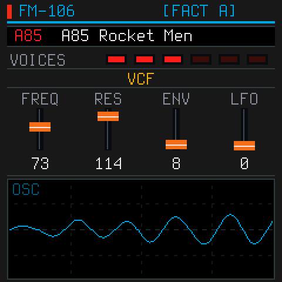
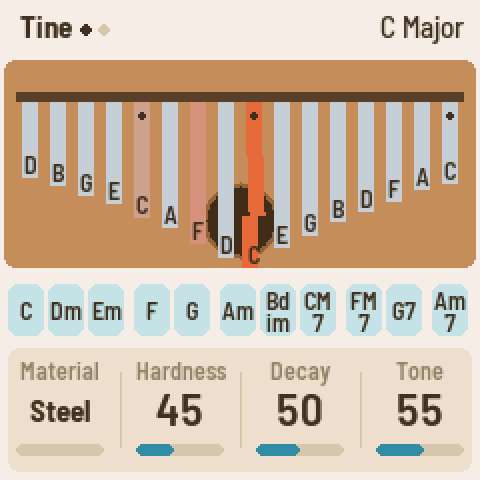
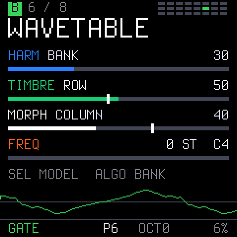
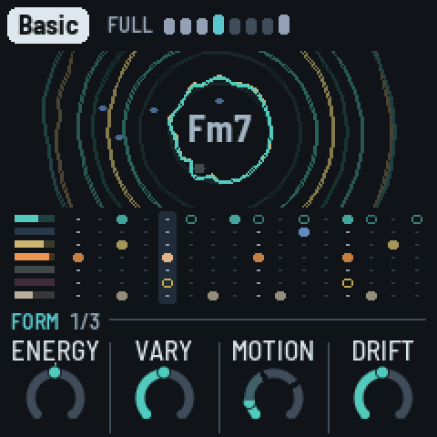

<p align="center">
  <picture>
    <source media="(prefers-color-scheme: dark)" srcset="docs/media/fm1-dock-light.svg">
    
  </picture>
</p>

<p align="center"><b>One firmware for the M-VAVE FM-1. Many synths.</b></p>

<p align="center">
  <a href="https://github.com/joakimeriksson/fm1-dock/releases/latest"></a>
  <a href="LICENSING.md"></a>
</p>

<p align="center">
  <a href="https://joakimeriksson.github.io/fm1-dock/"><b>The page</b></a>:
  <a href="https://joakimeriksson.github.io/fm1-dock/#install">install</a> ·
  <a href="https://joakimeriksson.github.io/fm1-dock/#modules">the catalog</a> ·
  <a href="https://joakimeriksson.github.io/fm1-dock/#play">the video</a> ·
  <a href="https://joakimeriksson.github.io/fm1-dock/#console">the console</a> ·
  <a href="https://joakimeriksson.github.io/fm1-dock/#emulator">the emulator</a> ·
  <a href="https://thefirmwarehub.com/#fw-fm1dock">on the FM-1 Firmware Hub</a>
</p>

fm1-dock is installed once. The synths are modules in its flash: hold HOME, pick another one, play. No reinstall.
Twelve modules so far, each its author's own code: four come with it, eight more go in from the page with one click,
and out again. Every one can be tried first, without an FM-1: its card's **Try it** runs it in the emulator on the page. Your own module deploys the same way, over USB in seconds, and when something goes wrong, the log, the
crash record and the render load are one click away in the browser. It also runs on the M-Vave SMK-37 keyboards.

<p align="center">
  
  
  
  
  
  
  <br>
  
  
  
  
  
  
</p>

## Install

1. Open **[the page](https://joakimeriksson.github.io/fm1-dock/#install)** in Chrome or Edge on a computer, plug in
   the FM-1 with a USB data cable and press **Connect over USB**. Nothing is written until you press a button.
2. Press **Install fm1-dock**. CS-1, Scintilla, OberVave and the sine come with it. Coming from an older fm1-dock,
   your added modules, settings and presets stay.
3. **Add** the modules you want from [the catalog](https://joakimeriksson.github.io/fm1-dock/#modules). Then hold
   HOME on the FM-1, pick a synth and play.

Every release is built from this source and signed on GitHub by the Firmware Hub's shared workflow
([zvenson/fm1-build](https://github.com/zvenson/fm1-build)), so each package carries a build attestation:

```sh
gh attestation verify fm1-dock-0.7.fwsc -R joakimeriksson/fm1-dock --signer-repo zvenson/fm1-build
```

fm1-dock is also on the [FM-1 Firmware Hub](https://thefirmwarehub.com/#fw-fm1dock), its card with the current release.

Without a browser, download `fm1-dock-X.Y.fwsc` from the [latest release](https://github.com/joakimeriksson/fm1-dock/releases/latest)
and install it over USB:

```sh
pip3 install mido python-rtmidi
python3 tools/fm1_install.py fm1-dock-0.7.fwsc   # asks before it writes, restarts into fm1-dock
```

**M-Vave SMK-37** (Pro, Elite, MKE-P37) and Donner Starrykey 37 Play: read [SMK37.md](SMK37.md) first. Each model has
its own package; the installers refuse an FM-1 package on an SMK-37, and the other way round.

Back to any other firmware, or the official one, with the [FM-1 Firmware Hub](https://fm1.designburgapps.com) in
Chrome or Edge: fm1-dock answers the hub's updater like every firmware there. Installing firmware is at your own risk.

## New in 0.7

- **Bluetooth MIDI that connects.** The radio calibrates itself at every start; a Mac connects in half a second and
  MIDI flows both ways, with both CPU cores running.
- **Five new modules**: FM-106, MONK-1, FiMba-1, GATOR and DUB-1.
- **The second core**: CS-1 plays half its voices on the chip's second CPU, FM-106 three of its six.
- **For every module**: a master EQ in the chip's hardware EQ, and MIDI CH, LOCAL, MIDI THRU, KNOBS CC and CC 7 volume.
- **Built and signed on GitHub**, with a build attestation.
- **The page** is a catalog and installer: your device, fm1-dock's install and update, every module with Add and
  Remove, and a meter for the flash they share.

The whole list: the [0.7 release notes](https://github.com/joakimeriksson/fm1-dock/releases/tag/v0.7).

## The modules

Each module is its author's own code, taken by a `take.py` (or wrapped) and changed only where a module's 272 KiB of
RAM needs it. The originals are linked; their manuals apply.

**In the package:**

| | by | voices | size | |
| --- | --- | --- | --- | --- |
| **CS-1** | twochannels | 8, two layers each | 52 KiB | A CS-80-style polysynth: two layers, its tone bars, effects and user presets, velocity and aftertouch from the keys. Half its voices on the second core. [The original](https://github.com/twochannels/CS-1). |
| **Scintilla** | Joakim Eriksson | 8 | 90 KiB | The 1981 Elka Synthex: all 80 factory patches, the laser harp ("Ring mod.") among them. Half its voices on the second core. [Its page](https://joakimeriksson.github.io/scintilla-fm1/). |
| **OberVave** | zvenson | 8, shared by four tracks | 149 KiB | A four-track analog-style poly with arpeggiator, sequencer and effects. [The original](https://github.com/zvenson/obervave). |
| **SINE** | zvenson (Dinghy) | 4 | in the host | Dinghy's sine: the fallback when a module fails, and the smallest module to copy. |

**Added with one click on [the page](https://joakimeriksson.github.io/fm1-dock/#modules)**, or with `tools/dock.py deploy`:

| | by | voices | size | |
| --- | --- | --- | --- | --- |
| **FM-106** | PatttF | 6, three on the second core | 100 KiB | The Roland Juno-106: the 128 factory presets, its BBD chorus, arpeggiator and sequencer. [The original](https://github.com/PatttF/fm-106), its app and DSP unchanged. |
| **MONK-1** | Charles Vestal | 1, up to 10 in unison | 240 KiB | Twelve singers on MonkSynth's formant voice, the mouth following the vowel; velocity and pressure from the keys. [The original](https://charlesvestal.github.io/fm1-monk/), unchanged in sound and screen (smaller buffers). |
| **FiMba-1** | Adam Sowers | 16 tines | 84 KiB | A kalimba by modal synthesis: tines on the white keys, thumb-roll chords on the black; its body, buzzers, the sound hole's wah under the keys' pressure, delay, plate reverb and tape. [The original](https://jadamsowers.github.io/fm1-fimba/), its screen drawn in strips. |
| **GATOR** | npi3pak | 1 (mono) | 185 KiB | A macro oscillator on Emilie Gillet's Plaits DSP: 24 models in 3 banks, a low-pass gate, two LFOs, an 8-slot modulation matrix and 16 presets. Not affiliated with Mutable Instruments. [The original](https://npi3pak.github.io/fm1-gator/). |
| **DUB-1** | sbegueria | 4 chord voices, 6 pings, a bass, 5 drums | 265 KiB | A generative dub techno machine, AMB-1's fork: chord stabs in a tape echo over a steady kick, eight pieces it plays by itself. [The original](https://sbegueria.github.io/fm1-dub/), its tape loop (4.2 s) and plate (16 bits) made to fit. |
| **FM-1 SID** | Joakim Eriksson | 3, the SID's | 266 KiB | C64 music: a cycle-exact 6510 and reSID, GoatTracker 2 songs and their editor; any `.sid` from [its page](https://joakimeriksson.github.io/fm1-emu/fm1-sid/) plays at once. [Write your first chiptune](https://github.com/joakimeriksson/fm1-sid#your-first-chiptune-step-by-step). |
| **AMB-1** | Charles Vestal | 4 pads, 6 bells, a bass, 3 drums | 76 KiB | A generative ambient machine after *Music for Airports*: it plays itself while you tend it. [The original](https://charlesvestal.github.io/fm1-amb/), its code unchanged. |
| **FoMni** | Charles Vestal | 16 strings, a 3-note chord, a bass | 139 KiB | A chord harp after the Omnichord: chords on the black keys, strummed on the white ones, with a rhythm box. [The original](https://charlesvestal.github.io/fm1-fomni/), its code unchanged. |

The added modules share 296 KiB of flash on an FM-1 (416 KiB on an SMK-37, in two areas); the page's meter shows what
fits before you add one. FM-1 SID, MONK-1 and DUB-1 are large: with one of them added, little else fits. The five new
modules are tested in the emulator, FiMba-1 also on an FM-1.

## Play it

<p align="center"></p>

| | |
| --- | --- |
| **HOME** | the picker (in a module that owns the whole panel: hold HOME alone for 1.5 s) |
| **SELECT / PRESETS** | move in the picker; **PLAY**, **SEL** or **HOME** load the module |
| **OPTIONS** (past the picker's last module) | **SEL** changes the option, **HOME** goes back |

fm1-dock starts whatever played last. The options, for every module:

| | |
| --- | --- |
| **CC7 VOLUME** | ON: MIDI CC 7 sets the level of whatever plays, on top of MASTER ((v/127)², back to 127 at every start). OFF (the default): CC 7 goes to the module, as before |
| **MASTER CC7** | ON: turning MASTER sends CC 7 on the keys' channel, over USB and BLE-MIDI |
| **MIDI CH** | ALL (the default), or 1..16: only that channel, which the module hears as channel 1, and the keys send on it. OberVave's tracks want ALL |
| **LOCAL** | OFF: the keys only send MIDI, so a computer playing them back gives no doubled notes. ON by default |
| **EQ** | LOW (a 150 Hz shelf), MID (a 1 kHz peak), HIGH (a 6 kHz shelf), ±12 dB each, before MASTER, in the chip's hardware EQ (about 3 % of a block). **SELECT** picks a band, **ALGORITHM** or **KNOB1..3** turn it, **SEL** switches the EQ ON / OFF or puts a band back to 0 dB. OFF by default; a boost can clip a loud module |
| **KNOBS CC** | ON: KNOB1..4 send CC 74, 71, 73, 72 (cutoff, resonance, attack, release) over USB and BLE-MIDI instead of turning the module's knobs. OFF by default |
| **MIDI THRU** | ON: the TRS MIDI jack's input (not clock or SysEx) goes on to USB-MIDI and BLE-MIDI, and the module plays it too. OFF by default |
| **BLUETOOTH** | BLE-MIDI, OFF by default (below) |

### Bluetooth MIDI

Switch **BLUETOOTH** ON in OPTIONS. A computer, phone or controller connects to `FM1-DOCK xxxx` without pairing, and
notes go both ways. The radio calibrates itself every time it starts, so the sound pauses for about 0.2 s; both CPU
cores keep running. A link that dies is let go and the FM-1 advertises again.

On a Mac: Audio MIDI Setup → Window → Show MIDI Studio → the Bluetooth button → **Connect** on `FM1-DOCK xxxx`.

### The second core

The second core starts at power-on and helps the modules that use it: CS-1 plays half its voices there, FM-106 three
of its six. The top line shows **2CPU** or **1CPU**. After a crash with both cores, fm1-dock runs on one until
power-off instead of crashing again.

### Safety nets

| | |
| --- | --- |
| **OCT+ at power-on** | safe start: the sine only, and the radio not started |
| **OCT− at power-on** | the USB rescue: no sound, only the updater, for any install |
| **HOME at power-on** | fm1-dock stays, even with a firmware in its boot slot |

Hold the keys from before you switch on until the screen shows something. A module that crashes twice in a row is
skipped at boot until you pick it again. One that renders slower than real time is stopped and the sine plays, so
USB and the updater keep working.

The boot slot (`tools/hbboot.py`, `tools/dock.py deploy --boot`) is a developer's tool: a whole firmware that takes
over at every power-on, with its own USB. Besides HOME at power-on, switching off while **STARTING** shows, twice in a
row, makes the third start stay in fm1-dock. Only put a firmware there that answers the installers.

## Your own module

A module is a table of functions (`render`, `note`, `ui`, `draw`, ...) at the start of its image. It links against
nothing of the host's, and the host checks its header, ABI and CRC before anything of it runs. Start from
[modules/sine/sine.c](modules/sine/sine.c) (about 150 lines); [firmware/dock/hb_module.h](firmware/dock/hb_module.h)
has every call the host gives it.

```sh
python3 tools/hbmod.py modules/mysynth                                        # -> build/modules/mysynth.dock
uv run --with python-rtmidi tools/dock.py deploy build/modules/mysynth.dock   # into the FM-1, running
uv run --with python-rtmidi tools/dock.py modules | logs | select NAME | delete NAME
uv run --with python-rtmidi tools/dock.py send FILE [--arg N]                 # a file into the RAM of the module playing
```

Or drop the `.dock` on the [console](https://joakimeriksson.github.io/fm1-dock/#console). A module has 272 KiB of RAM,
16 KiB of RAM code, a settings record and flash banks for presets; a deploy file is up to 272 KiB. A module that sets
`HB_F_DATA` gets what the computer sends it in its `data()` call, never written to flash: FM-1 SID takes a `.sid` that
way and plays it at once. A module ported to fm1-dock comes to the page's catalog with an entry in
[docs/modules/modules.json](docs/modules/modules.json), its `.dock` and a screenshot.

**Probes** measure the real chip: a small C program run once from RAM inside fm1-dock, its result back as JSON, and
the same probe in [fm1-emu](https://github.com/joakimeriksson/fm1-emu) for comparison:

```sh
tools/probe.py run probes/timing.c --on emu,fm1
```

## Build it

You need Linux on x86-64 (or macOS / Windows with Docker or WSL), Python 3 with Pillow, the JieLi toolchain and three
files of the JieLi AC79 SDK:

```sh
pip3 install Pillow mido python-rtmidi
tools/get_toolchain.sh                      # JieLi's clang for the chip, to ~/.jieli/toolchain
git clone --depth 1 --branch AC79NN_SDK_V1.2.1_2023-12-13 \
    https://gitee.com/Jieli-Tech/fw-AC79_AIoT_SDK.git ~/fw-AC79_AIoT_SDK
./build.sh      # -> build/fm1-dock.fwsc with CS-1, Scintilla, OberVave; the other modules as build/modules/*.dock
```

The build fails on what would brick the FM-1. `./build.sh --board smk37` builds for the SMK-37 ([SMK37.md](SMK37.md)).

In the emulator, without an FM-1 (the same package, and with `--flash` the same flash, deployed modules included):

```sh
fm1-live --fwsc build/fm1-dock.fwsc --flash flash.bin
tools/dock.py emu --fwsc build/fm1-dock.fwsc --deploy fm1sid.dock --ms 6000
```

The catalog's Try it runs fm1-emu's browser emulator with the module installed and picked: `tools/tryit.py` makes, from
each `.dock` the site serves, the flash a deploy leaves (so a 266 KiB module is there at boot, not after 100 s of SysEx
through the DIN jack) and the SELECT that picks it, for fm1-emu's page on the same origin (`?flash=`, `?script=`);
`tests/tryit_test.py` checks them against `dock.c` and in fm1-live, `--deploy` against a real deploy, sector for sector.

The platform underneath is Dinghy's: [docs/API.md](docs/API.md) (everything `platform.c` gives), [docs/RULES.md](docs/RULES.md)
(the chip's rules and what the build checks), [docs/MAKE-IT-YOURS.md](docs/MAKE-IT-YOURS.md).

## Credits

- **fm1-dock** (the host, the module interface, the tools, the page), **FM-1 SID** and **Scintilla**: Joakim Eriksson.
- **The modules**: CS-1, twochannels. OberVave, zvenson. FM-106, PatttF (its DSP after
  [ultramaster_kr106](https://github.com/kayrockscreenprinting/ultramaster_kr106)). AMB-1, FoMni and MONK-1, Charles
  Vestal (MONK-1's voice: Jonathan Taylor's MonkSynth). FiMba-1, Adam Sowers. GATOR, npi3pak (Plaits and stmlib:
  Emilie Gillet). DUB-1, sbegueria (after AMB-1). reSID: Dag Lem.
- **The base**: [Dinghy](https://github.com/zvenson/dinghy) (zvenson), on the platform of
  [Felucca](https://github.com/hugelton/Felucca) (Leo Kuroshita, Hügelton Instruments) as
  [SLOOP](https://github.com/isod89/sloop-fm1) (isod89) carries it.
- **Bluetooth MIDI**: [Optimist](https://github.com/w0ts/optimist)'s BLE-MIDI stack (w0ts). The radio's calibration
  (`fm1_rf_cal.h`): JieLi's AC79 SDK calibration, in C by Charles Vestal for [fm1-base](https://github.com/charlesvestal/fm1-base)
  and [Melodee](https://github.com/keremimo/melodee), Apache-2.0; its hooks after Melodee's.
- **The second core and the power-up**: Charles Vestal's [X0X](https://github.com/charlesvestal/fm1-x0x), after Kerem
  Kilic's Melodee, by way of SLOOP's dual-core branch (Andre Rezemini). From Melodee (Kerem Kilic): the supplies'
  start-up, in the form of Optimist's `fm1_supply.h`, and the second core's hold.
- **The SMK-37**: genkigenki's [fm1-to-smk37](https://github.com/genkigenki/fm1-to-smk37) kit and its reference port,
  SLOOP's `smk37` branch.
- The keys' force sensing comes from Velo, by way of CS-1. The font is Terminus (SIL OFL 1.1).

GPL-3.0-only: you may change and share it, and whoever gets your firmware gets its source. Who made what, file by
file, and the third-party parts: [LICENSING.md](LICENSING.md). Not affiliated with M-VAVE.
