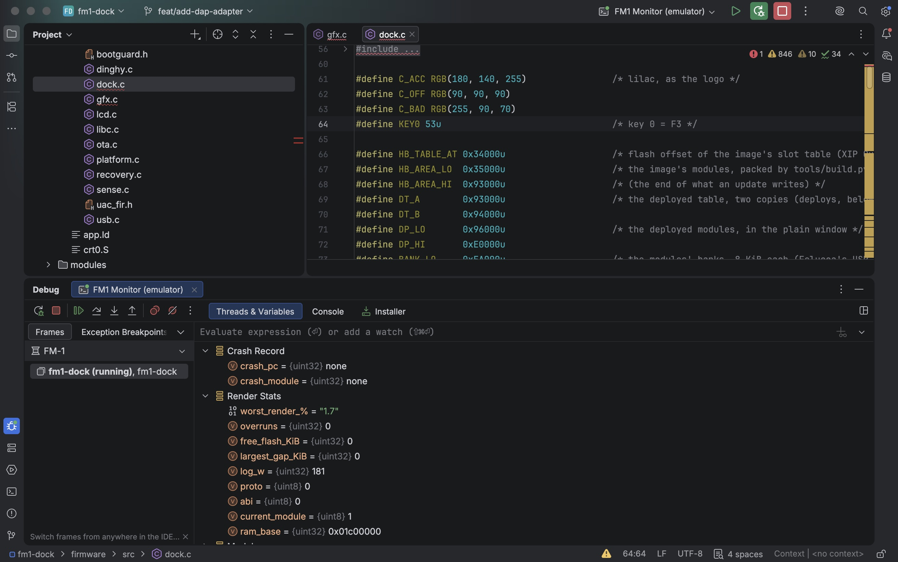
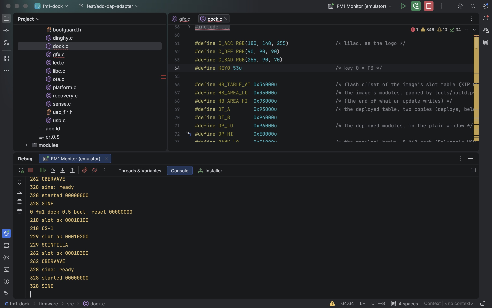
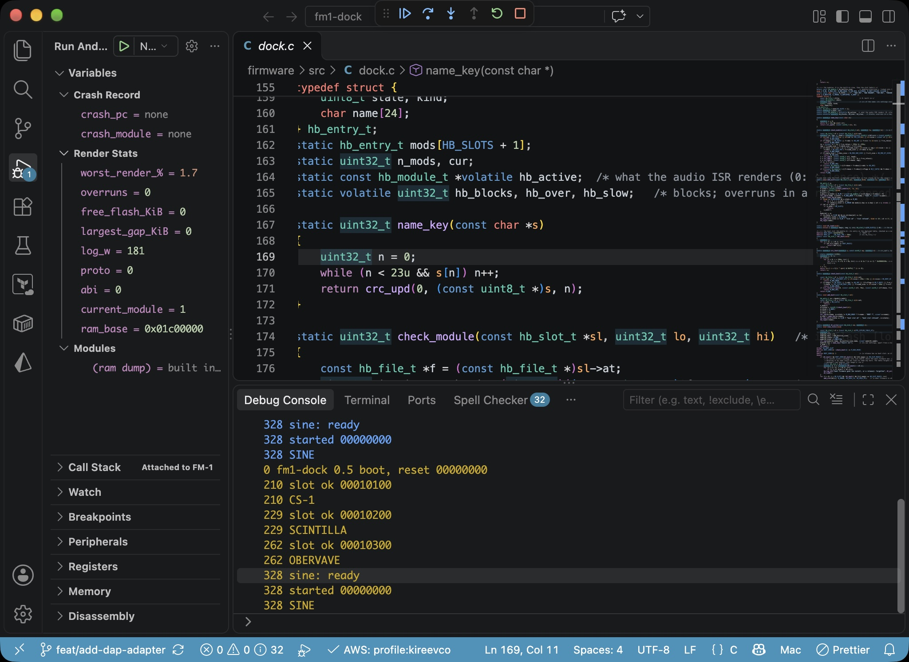

# Debugging fm1-dock from your IDE

The DAP adapter (`tools/fm1dap.py`) connects your IDE to a running FM-1 over
USB-MIDI SysEx, an emulator RAM dump, or synthetic mock data. It shows the
device's log, crash record, render stats, module list, and lets you read
arbitrary memory via the Memory Inspector.

## What you see

| IDE panel                    | What it shows                                      |
|------------------------------|----------------------------------------------------|
| **Debug Console**            | Boot log on connect, then live log (polled 5x/sec) |
| **Variables > Crash Record** | Last crash: PC, module index                       |
| **Variables > Render Stats** | Worst render %, overruns, flash free, log position  |
| **Variables > Modules**      | Loaded modules with state, version, size           |
| **Memory Inspector**         | Arbitrary reads (click the hex icon on `ram_base`) |

### IntelliJ IDEA: Variables and Crash Record



### IntelliJ IDEA: Boot log in Console



### VS Code: Variables, boot log, and Memory Inspector



## What it cannot do

No breakpoints, stepping, or source mapping. The JieLi pi32v2 SoC has no
hardware debug port and no public DWARF support. This is a diagnostic overlay,
not a full debugger.

## Backends

| Mode     | Flag           | What it reads                      |
|----------|----------------|------------------------------------|
| Live     | (default)      | FM-1 over USB-MIDI SysEx           |
| Emulator | `--emu`        | Boots emulator, reads RAM dump     |
| RAM dump | `--ram FILE`   | Pre-existing emulator RAM dump     |
| Mock     | `--mock`       | Synthetic data, no hardware needed |

## Requirements

- Python 3.10+
- python-rtmidi for live mode (`pip install python-rtmidi` or `uv run --with python-rtmidi`)
- fm1-emu/fm1-live for emulator mode (`task fm1-emu:download:fm1-emu`)

## VS Code setup

1. Copy the configs and extension source:

   ```sh
   cp -r docs/ide/.vscode .vscode
   ```

2. Build and install the debug extension:

   ```sh
   cd .vscode/extensions/fm1-dock-debug
   npx @vscode/vsce package
   code --install-extension fm1-dock-debug.vsix
   ```

3. Reload VS Code (Ctrl+Shift+P > "Developer: Reload Window").

Four configs appear in Run & Debug (Ctrl+Shift+D):

| Config                  | Request | What it does                         |
|-------------------------|---------|--------------------------------------|
| FM-1 Monitor (emulator) | launch  | Boots emulator, attaches to RAM dump |
| FM-1 Monitor (live)     | attach  | Connects to FM-1 over USB-MIDI      |
| FM-1 Monitor (mock)     | attach  | Synthetic data                       |
| FM-1 Monitor (RAM dump) | attach  | Reads `build/emu/ram.bin`            |

Press F5 to start. Boot log appears in the Debug Console. Variables with a
hex icon (e.g. `ram_base`) support "View Binary Data" to open the Memory
Inspector.

## IntelliJ IDEA setup (LSP4IJ plugin)

IntelliJ IDEA does not support DAP natively. Install the
[LSP4IJ](https://plugins.jetbrains.com/plugin/23257-lsp4ij) plugin (Red Hat,
IntelliJ 2024.2+):

1. Copy the run configs:

   ```sh
   cp -r docs/ide/.idea/runConfigurations .idea/runConfigurations
   ```

2. Install LSP4IJ: **Settings > Plugins > Marketplace**, search "LSP4IJ",
   install, restart.

3. Register a DAP server:
   **Settings > Languages & Frameworks > Debug Adapter Protocol > +**
   - **Name:** fm1-dock
   - **Command:** `python3 tools/fm1dap.py --emu` (or without `--emu` for live)
   - **Transport:** stdio

Click Debug (Shift+F9). The boot log appears in the Debug Console tab.

**Important:** the Debug Mode must be **Launch**. If IntelliJ resets it to
"Attach", you'll see `port out of range:-1`. Fix it in Edit Configurations.

## Neovim (nvim-dap)

```lua
local dap = require("dap")

dap.adapters["fm1-dock"] = {
    type = "executable",
    command = "python3",
    args = { "tools/fm1dap.py", "--emu" },
}

dap.configurations["c"] = dap.configurations["c"] or {}
table.insert(dap.configurations["c"], {
    type = "fm1-dock",
    request = "launch",
    name = "FM-1 Monitor (emulator)",
})
```

For live USB-MIDI, remove `"--emu"` from args and use `request = "attach"`.

## Debug Console commands

Type these in the Debug Console input field:

| Command              | What it does                          |
|----------------------|---------------------------------------|
| `peek 0x1C00000 16` | Read 16 words from address 0x1C00000  |
| `peek 0x1EEE240 4`  | Read 4 words (e.g. FM1_DBG registers) |
| `hello`              | Raw D_HELLO response as JSON          |
| `log`                | New log entries since last read       |

## Console mode

For a quick terminal check without an IDE:

```sh
python3 tools/fm1dap.py --emu --console
```

Prints crash record, render stats, modules, boot log, and hello JSON, then
exits. Useful for CI, SSH, or debugging the adapter itself.

## How it works

```
IDE (VS Code / IntelliJ / Neovim)
        |
   DAP JSON-RPC (stdin/stdout)
        |
tools/fm1dap.py
   reuses tools/hbdeploy.py for SysEx transport
        |
   USB-MIDI SysEx          or     RAM dump file
        |                               |
FM-1 hardware                  fm1-emu emulator
```

The adapter maps DAP requests to existing firmware commands:

| DAP request   | Firmware command       |
|---------------|------------------------|
| launch/attach | D_HELLO (0x01)         |
| variables     | D_HELLO, D_LIST (0x02) |
| readMemory    | peek probe / RAM read  |
| evaluate      | peek, hello, log       |
| output events | D_LOG (0x20) polled    |
| stopped event | D_HELLO crash_pc != 0  |

No firmware changes are needed. The adapter uses the same SysEx protocol as
`tools/dock.py` and `tools/hbdeploy.py`.

## Emulator mode (`--emu`)

When launched with `--emu`, the adapter:

1. Finds `fm1-emu` or `fm1-live` on PATH or in `~/.fm1-emulator/bin/`
2. Boots the firmware (`docs/fm1-dock-0.5.fwsc`) for 2000 ms
3. Writes RAM dump to `build/emu/ram.bin`
4. Attaches to the RAM dump as if `--ram` was passed

The emulator's stderr (boot info, LED fractions) appears in the IDE's process
output. The DAP adapter's output (boot log, variables) appears in the Debug
Console.
